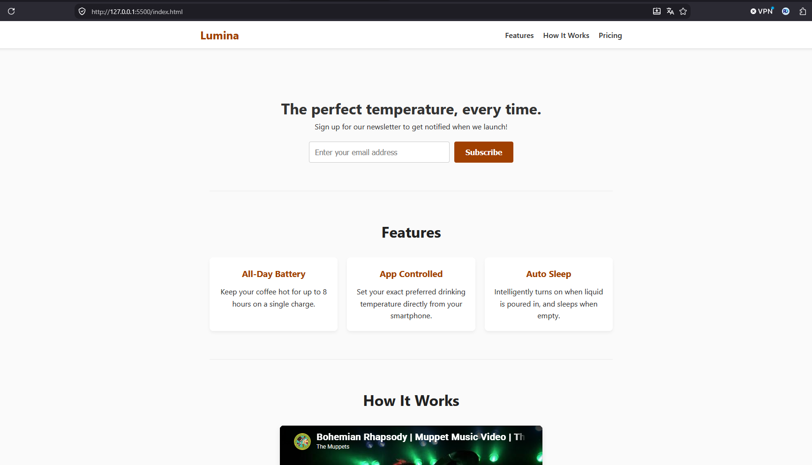

# Lumina Smart Mug


Landing page du produit Lumina Smart Mug : inscription à la newsletter avec double opt-in, désinscription en un clic, politique de confidentialité, présentation des fonctionnalités, vidéo de démonstration et bloc de précommande. Né d'un projet freeCodeCamp (Responsive Web Design).



## Où en est le projet (V3)

- **Désinscription** : chaque email contient un lien de désinscription personnel (jeton aléatoire de 64 caractères, seul son hash SHA-256 est stocké). Comme pour la confirmation, le lien ouvre une page avec un bouton : seul le clic (POST) désinscrit, pour qu'un scanner de messagerie ne le fasse pas à la place de la personne.
- **Désinscription en un clic depuis la messagerie** : les emails portent les en-têtes `List-Unsubscribe` et `List-Unsubscribe-Post` (RFC 8058), ce qui permet à Gmail ou Yahoo d'afficher leur propre bouton « Se désabonner ».
- **Politique de confidentialité** (`privacy.html`) : données collectées, pseudonymisation de l'IP, prestataire d'envoi déclaré comme tiers, droits d'accès, de correction et de suppression. Le lien est placé à côté de la case de consentement, et la version du consentement (`newsletter-v2`) est enregistrée avec chaque inscription.
- **Envoi d'email réel par SMTP** via PHPMailer : un mode `smtp` s'ajoute au mode `outbox` (développement). Emails en HTML avec une version texte de secours. Le fournisseur n'est pas figé dans le code : tout serveur SMTP avec STARTTLS ou SSL convient (Brevo, SMTP2GO, Mailjet, dont les quotas gratuits sont à vérifier au moment du choix).
- **Erreurs** : toute exception ou erreur PHP (y compris une classe introuvable après un envoi FTP incomplet) renvoie une réponse générique au visiteur ; la cause réelle est écrite dans le journal du serveur, jamais affichée.
- Hérité de la V2 : double opt-in avec jeton à 48 h, honeypot, IP pseudonymisée par HMAC-SHA256, réponse identique pour une adresse déjà inscrite. Hérité de la V1 : structure `public/` / `src/` / `config/` / `storage/`, en-têtes de sécurité via `.htaccess`, bouton « Pre-order Now » désactivé (V4).

## Ce que j'ai mis en pratique

- Gestion du cycle de vie d'un abonné (`pending`, `confirmed`, `unsubscribed`) avec deux jetons distincts, et renouvellement des jetons quand une adresse désinscrite se réinscrit.
- Dépendance gérée avec Composer (PHPMailer) derrière une interface (`MailerInterface`) : le service ne sait pas s'il écrit un fichier ou parle à un serveur SMTP.
- En-têtes d'email standards pour la désinscription en un clic (RFC 8058) et email HTML en tableaux avec version texte alternative.
- Gestion d'erreurs au bon niveau : `Throwable` capturé à la frontière du service, journalisation côté serveur, message neutre côté visiteur.
- Pseudonymisation de l'IP, consentement versionné et politique de confidentialité qui décrit uniquement ce que le code fait réellement.
- Séparation interface / implémentation (`SubscriberStore` / `SubscriberRepository`) et enums PHP natifs pour les résultats (`SubscribeOutcome`, `ConfirmOutcome`, `UnsubscribeOutcome`).

## Démo

[Voir la démo en ligne](https://lumina-smart-mug.kesug.com/)

## Stack technique

- PHP 8.4
- MySQL 8 ou MariaDB 10.5+ (PDO, requêtes préparées)
- PHPMailer 7 (installé avec Composer)
- HTML5 / CSS3
- JavaScript (vanilla, sans dépendance)
- Apache (`.htaccess`) pour les en-têtes de sécurité et la protection des dossiers sensibles

## Installation locale

```bash
git clone https://github.com/DocariDR/lumina-smart-mug.git
cd lumina-smart-mug
composer install
cp config/config.example.php config/config.php
```

Renseigne dans `config/config.php` tes identifiants de base de données locale et un `ip_salt` d'au moins 32 caractères (par exemple `openssl rand -hex 32`), puis importe le schéma :

```bash
mysql -u UTILISATEUR -p NOM_DE_BASE < db/schema.sql
php -S localhost:8000 -t public
```

Ouvre ensuite `http://localhost:8000`. Avec `'mailer' => 'outbox'`, les emails atterrissent dans `storage/outbox/` : les liens de confirmation et de désinscription s'y trouvent. Pour un vrai envoi, passe à `'mailer' => 'smtp'` et renseigne le bloc `mail` (hôte, port, identifiants, adresse d'expédition).

### Déploiement sur hébergement mutualisé

1. Crée une base `utf8mb4` et un utilisateur dédié, puis importe `db/schema.sql`.
2. Pointe le domaine vers le dossier `public/` comme racine web (ou utilise la redirection `htdocs/.htaccess` si l'hébergeur l'impose), avec `src/`, `config/` et `storage/` hors de portée du web.
3. Sans accès à Composer sur le serveur : lance `composer install --no-dev --optimize-autoloader` en local, puis envoie tout le dossier `vendor/` par FTP et vérifie qu'il est complet (`vendor/autoload.php`) avant de passer en mode `smtp`.
4. Vérifie que la version PHP active du domaine est 8.4, et que `config/` et `storage/` répondent 403 ou 404 depuis le navigateur.

## Structure des fichiers

```
lumina-smart-mug/
├── public/                         # Racine web : seul dossier exposé
│   ├── index.html
│   ├── privacy.html
│   ├── subscribe.php
│   ├── confirm.php
│   ├── unsubscribe.php
│   ├── .htaccess
│   └── assets/
│       ├── css/
│       │   ├── styles.css
│       │   └── v3-overrides.css
│       └── js/form.js
├── src/
│   ├── bootstrap.php                # Autoload + fonctions communes
│   ├── services.php                 # Câblage des dépendances
│   ├── Database/
│   │   ├── Connection.php
│   │   └── DuplicateKeyException.php
│   ├── Mail/
│   │   ├── MailerInterface.php
│   │   ├── OutboxMailer.php
│   │   └── SmtpMailer.php
│   └── Subscription/
│       ├── EmailValidator.php
│       ├── SubscribeOutcome.php
│       ├── ConfirmOutcome.php
│       ├── UnsubscribeOutcome.php
│       ├── SubscriberStore.php
│       ├── SubscriberRepository.php
│       └── SubscriptionService.php
├── db/
│   └── schema.sql
├── config/
│   ├── config.example.php
│   └── .htaccess
├── storage/
│   └── .htaccess
├── composer.json
├── .gitignore
└── README.md
```

## Auteur

Ricardo Dovonou (DocariDR)

- GitHub : [github.com/DocariDR](https://github.com/DocariDR)
- LinkedIn : [linkedin.com/in/ricardo-dovonou](https://linkedin.com/in/ricardo-dovonou)
- X : [x.com/DocariDR](https://x.com/DocariDR)
- Bluesky : [bsky.app/profile/docaridr.bsky.social](https://bsky.app/profile/docaridr.bsky.social)
- Portfolio : [portfolio-docaridr.vercel.app](https://portfolio-docaridr.vercel.app)