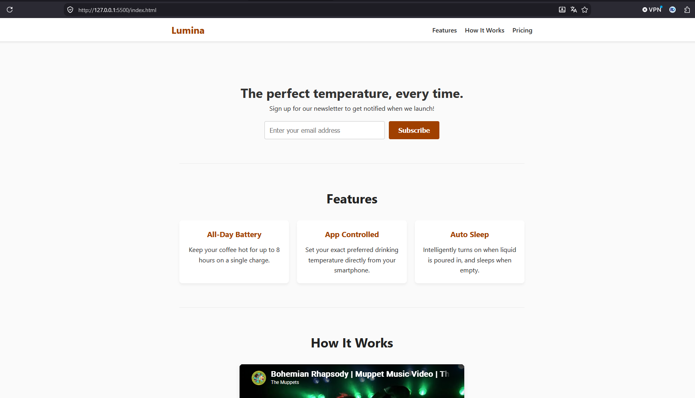

# Lumina Smart Mug


Landing page du produit Lumina Smart Mug : inscription à la newsletter avec double opt-in, présentation des fonctionnalités, vidéo de démonstration et bloc de précommande. Né d'un projet freeCodeCamp (Responsive Web Design).



## Où en est le projet (V2)

- **Inscription en deux temps (double opt-in)** : l'adresse est enregistrée avec le statut `pending`, un jeton aléatoire de 64 caractères est envoyé par email (seul son hash SHA-256 est stocké, il expire après 48 heures). Le statut ne passe à `confirmed` qu'après confirmation.
- **Confirmation en deux étapes** : le lien de l'email ouvre une page avec un bouton (un simple GET ne confirme rien) ; seul le clic (POST) valide l'inscription. Ça évite qu'un scanner de sécurité de messagerie consomme le jeton à la place de la personne.
- **Anti-spam et vie privée** : un champ honeypot invisible piège les robots sans rien enregistrer ; l'adresse IP n'est jamais stockée en clair (pseudonymisée par HMAC-SHA256) ; une adresse déjà confirmée reçoit la même réponse qu'une nouvelle inscription, sans email, pour ne pas révéler qui est abonné.
- **Pannes de base de données** : réponse générique (503), jamais de détail technique affiché ; `display_errors` désactivé indépendamment du mode d'exécution de PHP (`ini_set`, pas seulement `.htaccess`).
- **Envoi d'email en mode `outbox`** (développement uniquement) : les emails sont écrits dans un dossier au lieu d'être réellement envoyés. **L'envoi SMTP réel arrive en V3** ; en attendant, seule la V1 (sans newsletter fonctionnelle) est en ligne.
- Hérité de la V1 : structure `public/` (seul dossier exposé au web) / `src/` / `config/` / `storage/`, bouton "Pre-order Now" désactivé (V4), en-têtes de sécurité via `.htaccess`.

## Ce que j'ai mis en pratique

- Modélisation d'une table MySQL (`ENUM`, contrainte d'unicité, index) et accès via PDO en requêtes préparées (`PDO::ATTR_EMULATE_PREPARES` désactivé pour de vraies requêtes préparées côté serveur).
- Séparation interface / implémentation (`SubscriberStore` / `SubscriberRepository`, `MailerInterface` / `OutboxMailer`) pour pouvoir tester le service sans base de données ni envoi d'email réel.
- Jetons cryptographiques à usage unique : génération aléatoire (`random_bytes`), stockage du hash uniquement (jamais le jeton en clair), expiration, invalidation après usage.
- Pseudonymisation d'une donnée personnelle (IP) par HMAC avec un sel secret, plutôt qu'un stockage en clair.
- Enums PHP natifs (`SubscribeOutcome`, `ConfirmOutcome`) pour représenter les résultats d'une opération, plutôt que des chaînes libres.
- Honeypot anti-spam accessible : champ cerné de `aria-hidden` et `tabindex="-1"`, masqué par positionnement hors-écran plutôt que `display: none`.

## Démo

[Voir la démo en ligne](https://lumina-smart-mug.kesug.com/)

## Stack technique

- PHP 8.4
- MySQL 8 ou MariaDB 10.5+ (PDO, requêtes préparées)
- HTML5 / CSS3
- JavaScript (vanilla, sans dépendance)
- Apache (`.htaccess`) pour les en-têtes de sécurité et la protection des dossiers sensibles

## Installation locale

```bash
git clone https://github.com/DocariDR/lumina-smart-mug.git
cd lumina-smart-mug
cp config/config.example.php config/config.php
```

Renseigne dans `config/config.php` tes identifiants de base de données locale et un `ip_salt` (par exemple généré avec `openssl rand -hex 32`), puis importe le schéma :

```bash
mysql -u UTILISATEUR -p NOM_DE_BASE < db/schema.sql
php -S localhost:8000 -t public
```

Ouvre ensuite `http://localhost:8000`. En mode `outbox`, les emails de confirmation atterrissent dans `storage/outbox/` au lieu d'être envoyés : le lien de confirmation s'y trouve.

### Tests (optionnel)

```bash
composer install
vendor/bin/phpunit
```

### Déploiement sur hébergement mutualisé

1. Crée une base `utf8mb4` et un utilisateur dédié, puis importe `db/schema.sql`.
2. Pointe le domaine vers le dossier `public/` comme racine web. Si l'hébergeur impose `public_html/`, dépose le contenu de `public/` dans `public_html/` et place `src/`, `config/` et `storage/` un niveau au-dessus, hors de portée du web.
3. Vérifie dans le panneau de l'hébergeur que la version PHP active du domaine est bien 8.4.
4. Vérifie que `config/` et `storage/` ne sont pas accessibles depuis le navigateur (réponse 403 ou 404 attendue).

## Structure des fichiers

```
lumina-smart-mug/
├── public/                         # Racine web : seul dossier exposé
│   ├── index.html
│   ├── subscribe.php
│   ├── confirm.php
│   ├── .htaccess
│   └── assets/
│       ├── css/styles.css
│       └── js/form.js
├── src/
│   ├── bootstrap.php                # Autoload + fonctions communes
│   ├── services.php                 # Câblage des dépendances
│   ├── Database/
│   │   ├── Connection.php
│   │   └── DuplicateKeyException.php
│   ├── Mail/
│   │   ├── MailerInterface.php
│   │   └── OutboxMailer.php
│   └── Subscription/
│       ├── EmailValidator.php
│       ├── SubscribeOutcome.php
│       ├── ConfirmOutcome.php
│       ├── SubscriberStore.php
│       └── SubscriberRepository.php
├── db/
│   └── schema.sql
├── config/
│   ├── config.example.php
│   └── .htaccess
├── storage/
│   └── .htaccess
├── composer.json
├── .gitignore
└── README.md
```

## Auteur

Ricardo Dovonou (DocariDR)

- GitHub : [github.com/DocariDR](https://github.com/DocariDR)
- LinkedIn : [linkedin.com/in/ricardo-dovonou](https://linkedin.com/in/ricardo-dovonou)
- X : [x.com/DocariDR](https://x.com/DocariDR)
- Bluesky : [bsky.app/profile/docaridr.bsky.social](https://bsky.app/profile/docaridr.bsky.social)
- Portfolio : [portfolio-docaridr.vercel.app](https://portfolio-docaridr.vercel.app)